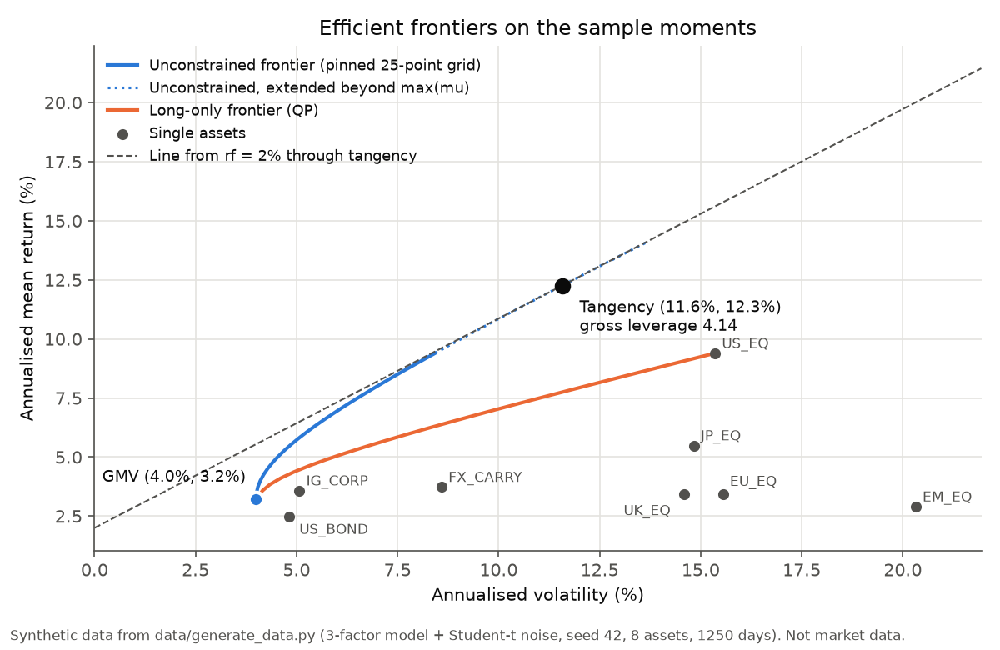
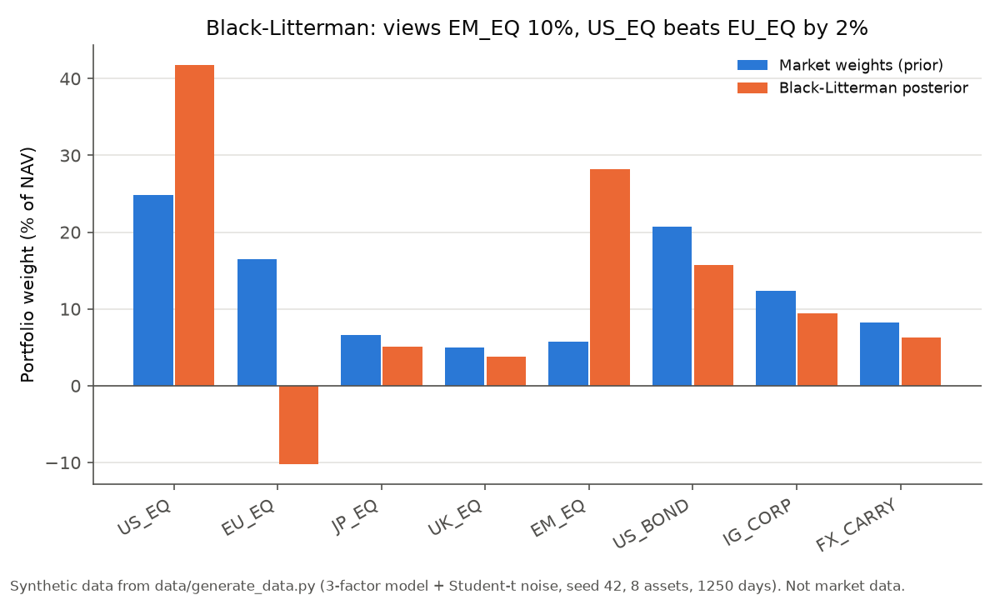
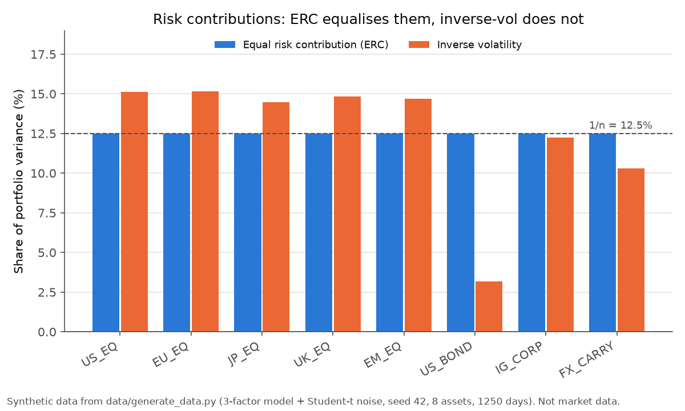

# portfolio-construction

[](https://github.com/AshJha0/portfolio-construction/actions/workflows/ci.yml)
[](LICENSE)
[](CHANGELOG.md)

Markowitz, Black-Litterman and risk parity, written four times: a Python
reference and ports in C++26, Rust and Java 25.

## What this is and who it is for

Portfolio construction answers one question: given a set of assets, how
much of each should we hold? This repository implements the classical
answers. Mean-variance optimisation trades expected return against risk.
Black-Litterman starts from the weights the market already holds and tilts
them towards a few stated views. Risk parity ignores expected returns and
spreads risk evenly. Each method is small enough to read in an afternoon,
and the guide in [LEARN.md](LEARN.md) explains the ideas from first
principles.

We wrote it for two readers. A student can run one command per language,
read the code next to the guide, and see every number in this page
reproduced. A reviewer can check that the four implementations agree: every
algorithm is pinned step by step in [API_SPEC.md](API_SPEC.md), and all four
test suites check the same 23 golden cases in `data/golden/golden.json`.
The Python library depends only on numpy, and the ports call no numerical
library at all (no BLAS, LAPACK or solver); the Rust crate's only
dependencies are serde and serde_json, for reading the data files.

> **The bundled data is synthetic.** `data/asset_returns.csv` is simulated
> by [`data/generate_data.py`](data/generate_data.py): 8 assets named after
> asset classes (US_EQ, EU_EQ, JP_EQ, UK_EQ, EM_EQ, US_BOND, IG_CORP,
> FX_CARRY), 1250 daily returns, drawn from a three-factor model (global
> equity, rates, carry) with Gaussian factors plus Student-t noise with 6
> degrees of freedom, constant annual drifts, `numpy.random.default_rng(42)`.
> Market caps in `data/market_caps.csv` are fixed numbers, constant over the
> whole sample. Nothing here is market data, and the backtest table below is
> a demonstration of the code paths, not evidence about any real strategy.
>
> One number shows how far sample estimates can sit from the truth even on
> clean simulated data: EM_EQ is generated with a 9.0% annual drift
> (`MU_ANNUAL` in the generator), and its sample mean over the 1250 days is
> 2.9% (first table of `python python/demo.py`).

## Figures

All three are drawn by [`docs/make_figures.py`](docs/make_figures.py) from
the synthetic data through the public `portopt` API.



The unconstrained frontier allows short positions; the long-only frontier
(solved by the active-set QP) does not, so it lies to the right. The
tangency portfolio at rf = 2% has gross leverage 4.14, which is the
estimation-error problem LEARN.md discusses.



Two views (EM_EQ returns 10%, US_EQ beats EU_EQ by 2%) move weight into
EM_EQ and US_EQ and take EU_EQ short. The five assets without a view all
shrink by about the same factor (JP_EQ 6.6% to 5.0%, US_BOND 20.7% to
15.7%), so their proportions to one another are kept.



Each bar is the share of portfolio variance an asset contributes. ERC makes
all eight equal to 12.5% (spread 1.3e-12 in the demo); inverse volatility
ignores correlation, so the correlated equities carry more than their share.

## Quickstart

Clone once, then pick a language. The commands are the ones CI runs
(`.github/workflows/ci.yml`).

```bash
git clone https://github.com/AshJha0/portfolio-construction
cd portfolio-construction
```

### Python (3.11 or later)

```bash
python -m pip install -e "python[dev]"   # numpy; pytest, scipy, ruff, mypy for development
pytest -q python                         # 114 tests, including the golden suite
python python/demo.py                    # end-to-end demo
```

To redraw the figures: `python -m pip install -e "python[docs]"` (adds
matplotlib), then `python docs/make_figures.py`.

### C++ (C++26, CMake 3.25 or later)

```bash
cmake -S cpp -B cpp/build -DCMAKE_BUILD_TYPE=Release
cmake --build cpp/build --config Release --parallel
ctest --test-dir cpp/build -C Release --output-on-failure
cd cpp && ./build/portopt_demo            # Windows: build\Release\portopt_demo.exe
```

GoogleTest is used from the system when CMake finds it and fetched
otherwise. CI builds with GCC 14, Clang and MSVC (`/std:c++latest`).

### Rust (stable; MSRV in `rust/Cargo.toml`)

```bash
cd rust
cargo test --release
cargo run --release --bin demo
```

### Java (JDK 25, Maven)

```bash
cd java
mvn -B verify          # compile and run the JUnit suite
mvn -B -q exec:java    # demo
```

### Regenerating the data and goldens

```bash
python data/generate_data.py
```

This rewrites the CSV, the views, the config and `golden.json`, and before
writing it re-checks the reference against independent computations (see
[Testing](#testing-and-cross-language-agreement)). Never edit the goldens by
hand; see [CONTRIBUTING.md](CONTRIBUTING.md).

## Feature matrix

Python names; the ports use the same names in each language's casing
(`portopt::` in C++, crate `portopt` in Rust, `com.quant.portopt` in Java).

| Area | Functions | Pinned behaviour (API_SPEC.md) |
|---|---|---|
| Moments | `sample_mean`, `sample_cov`, `annualize_mean`, `annualize_cov` | mean divides by T, covariance by T-1; correctly rounded sums; annualise by `periods` (default 252) |
| Shrinkage | `shrink_covariance` | Ledoit-Wolf (2004) constant-correlation target, intensity per Appendix B and the authors' `covCor.m` |
| Linear algebra | `cholesky`, `chol_solve`, `spd_solve`, `spd_inverse` | Cholesky-Banachiewicz, relative pivot gate 1e-13; every inverse is two triangular solves |
| Closed-form Markowitz | `two_fund_scalars`, `min_variance_weights`, `tangency_weights`, `frontier_weights`, `efficient_frontier`, `gross_leverage` | A, B, C, D scalars; 25-point grid; `TangencyUndefinedError` when rf is at or above A/C, or within a relative 1e-6 of it |
| Constrained Markowitz | `project_simplex_box`, `attainable_return_range`, `min_variance_longonly[_solve]`, `constrained_frontier[_solve, _weights]` | sort-based box-simplex projection; Goldfarb-Idnani dual active-set QP with a KKT residual; the `_solve` forms return `QpResult`, the weights-only forms raise if not certified |
| Black-Litterman | `implied_equilibrium_returns`, `views_to_matrices`, `default_omega`, `bl_posterior`, `bl_weights` | reverse optimisation; absolute and relative views; He-Litterman Omega scaled by per-view confidence; one k-by-k Cholesky solve |
| Risk parity | `risk_contributions`, `erc_weights`, `risk_budget_solve`, `risk_budget_weights`, `inverse_vol_weights` | cyclical coordinate descent on Spinu's log-barrier form, tol 1e-10, at most 10,000 sweeps |
| Backtest | `rebalance_indices`, `run_backtest`, `annualized_return`, `annualized_vol`, `sharpe_ratio`, `max_drawdown` | expanding window 500 rows, re-estimate every 63 rows, L1 turnover between target vectors |

## Demo output

`python python/demo.py` prints the following (first line and some rows
omitted). The C++, Rust and Java demos print the same numbers; the CI
demo-diff job compares them.

```
assets: US_EQ, EU_EQ, JP_EQ, UK_EQ, EM_EQ, US_BOND, IG_CORP, FX_CARRY

=== Estimators (annualized, Ledoit-Wolf constant-correlation shrinkage)
shrinkage intensity delta = 0.007212   rbar = 0.4172
asset          mean  vol(sample)  vol(shrunk)
US_EQ        0.0940       0.1535       0.1535
EM_EQ        0.0290       0.2032       0.2032
US_BOND      0.0248       0.0481       0.0481
...

=== Efficient frontier sweeps (25 points each, showing every 4th) =====
unconstrained grid: A/C .. max(mu);  long-only grid: constrained GMV .. max(mu)
  target  vol uncon    target  vol long-only
  0.0322     0.0400    0.0304         0.0404
  0.0631     0.0545    0.0622         0.0826
  0.0940     0.0843    0.0940         0.1535
tangency (rf=2.00%): sharpe = 0.8865, gross leverage = 4.14

=== Black-Litterman: prior (equilibrium) vs posterior weights =========
view: EM_EQ returns 10.0% (confidence 1.0)
view: US_EQ beats EU_EQ by 2.0% (confidence 0.5)
                  US_EQ    EU_EQ    JP_EQ    UK_EQ    EM_EQ  US_BOND  IG_CORP FX_CARRY
pi (equil.)      0.0326   0.0321   0.0279   0.0281   0.0385   0.0001   0.0064   0.0097
mu posterior     0.0531   0.0459   0.0430   0.0439   0.0694  -0.0007   0.0093   0.0149
w market         0.2479   0.1653   0.0661   0.0496   0.0579   0.2066   0.1240   0.0826
w posterior      0.4172  -0.1024   0.0504   0.0378   0.2824   0.1574   0.0944   0.0629
posterior gross leverage = 1.2049

=== Risk contributions: ERC vs inverse-vol ============================
w ERC            0.0579   0.0568   0.0620   0.0617   0.0444   0.4037   0.1756   0.1379
RC ERC           0.1250   0.1250   0.1250   0.1250   0.1250   0.1250   0.1250   0.1250
RC spread: ERC 1.30e-12, inv-vol 1.20e-01

=== Backtest: re-estimated every 63 days, daily constant mix (holdout = last 750d)
method          ann ret  ann vol   sharpe   max DD  avg turno
equal_weight     0.0614   0.0930   0.4454   0.1868     0.0000
min_var_lo       0.0479   0.0402   0.6948   0.0589     0.0273
tangency         0.4835   0.5749   0.8062   0.4700    18.1968
black_litt       0.0701   0.1070   0.4687   0.2331     0.0174
erc              0.0528   0.0516   0.6365   0.1019     0.0051
inverse_vol      0.0564   0.0630   0.5783   0.1235     0.0043
note: tangency undefined/ill-conditioned at 8 rebalance date(s) (rf at or above the min-var return); fell back to min-variance there.
```

### What the backtest section measures

The heading says what it is: a **daily-rebalanced constant mix whose
target is re-estimated every 63 days**.

In plain words: every 63 trading days we recompute the target weights from
all the data seen so far, and on every day in between we hold exactly those
weights, as if we traded back to them each morning at no cost.

Formally (`python/src/portopt/backtest.py`, API_SPEC.md section 6): with
window W = 500 and step 63, the re-estimation dates are
`t_k = 500 + 63k` while `t_k < T`. The weight function sees rows
`[0, t_k)`, and the portfolio return on each day `t` of the next block is
`w_k' r_t`. Turnover at date k is `sum_i |w_k[i] - w_{k-1}[i]|`, between
consecutive *targets*. The drift between targets is never traded or
counted, and no transaction cost is charged anywhere.

Worked example: T = 1250 gives dates 500, 563, ..., 1193, which is 12
re-estimations and 11 turnover values over a 750-day holdout. The tangency
row's average turnover of 18.2 means the target moved by 18 times NAV, on
average, at each of those 11 dates. A real desk could not trade that, and
the tangency row's 48% return should be read with that in mind and with
the synthetic data in mind.

## What this is not

- **Not a source of investment results.** The data is simulated (above).
  None of the backtest numbers say anything about markets.
- **Not a realistic backtest.** No transaction costs, no drift between
  re-estimations, no calendar, no benchmark statistics, no Sharpe standard
  error (`python/src/portopt/backtest.py`).
- **Not a large-scale optimiser.** Linear algebra is dense with an O(n^3)
  Cholesky per solve, and the QP refactors its working set every iteration.
  We size it for n up to about 20 assets.
- **Not a covariance repair tool.** A singular or near-singular covariance
  is rejected by the Cholesky pivot gate, never regularised. Shrink first
  (`shrink_covariance`) when T is small relative to n.
- **Not investment advice.** See the licence.

## Testing and cross-language agreement

`data/golden/golden.json` holds 23 named cases with a flat schema
(`{"cases": [{"name", "inputs", "expect", "tol"}]}`); vectors are flattened
as `w_0..w_7` and matrix entries as `cov_i_j`. The Python reference
produced every value from `data/asset_returns.csv` as parsed (the CSV
stores doubles with `%.17g`, so they round-trip exactly).

Before writing, `data/generate_data.py` re-checks the reference against
independent computations: the closed forms against `numpy.linalg.lstsq`,
the Ledoit-Wolf intensity against a transcription of `covCor.m`, the four
QP cases against scipy SLSQP (KKT residual below 1e-12), the ERC
equal-contribution identity, and both Black-Litterman limits (tau to 0,
Omega to infinity).

Each test suite loads the same file, asserts the case count and checks
`|got - expect| <= tol` entry by entry: analytic quantities at 1e-10 to
1e-12, QP cases at 1e-10, CCD and backtest metrics at 1e-8 or 1e-9.
Agreement is a rounding question rather than an iteration-path question,
because each golden quantity is either a closed form or the exact output
of a finite algorithm (the QP is polished on its final active set), and
long sums are correctly rounded in Python (`math.fsum`) and Neumaier
compensated in the ports.

The library itself has no random number generator. Only the data
generator draws random numbers.

## Practical notes

- **Units.** Inputs are daily simple returns as decimals (0.01 = 1%).
  `annualize_*` multiplies by `periods`, default 252; pass 260 or 365 if
  your desk uses those. Covariance uses T-1. Weights sum to 1 and a
  negative weight is a short. `rf` is an annual decimal.
- **Black-Litterman works in excess returns** (`pi = delta Sigma w_mkt`),
  so `bl_weights` uses rf = 0 by default. Its weights come from the
  tangency formula and therefore sum to 1 by construction
  (`python/src/portopt/black_litterman.py`).
- **Validation at every public entry point:** NaN or infinity, returns at
  or below -1, shape mismatches, asymmetric or non-SPD covariance,
  `periods <= 0`, non-finite rf, infeasible bounds, unattainable targets,
  degenerate frontiers, malformed views, `tau` outside (0, 1],
  `delta <= 0`. Errors are the language's standard invalid-input type and
  name the offending argument.
- **Convergence.** The QP `_solve` functions return `converged`,
  `kkt_residual` and `iterations`, and the weights-only wrappers raise when
  the certificate fails. `risk_budget_solve` returns
  `(weights, sweeps, converged)`; `erc_weights` and `risk_budget_weights`
  return the weights only and do not raise at the sweep cap, so call
  `risk_budget_solve` when you need to know.
- **Leverage.** Unconstrained tangency and Black-Litterman weights are not
  bounded. Check `gross_leverage` (4.14 for the demo tangency).

## Repository layout

```
README.md, LEARN.md, COOKBOOK.md, API_SPEC.md, CHANGELOG.md, CONTRIBUTING.md, SECURITY.md
docs/       index.html (the Pages site), ARCHITECTURE.md, diagrams/, make_figures.py, img/
data/       asset_returns.csv, market_caps.csv, views.json, config.json,
            generate_data.py, golden/golden.json
python/     pyproject.toml, src/portopt/, tests/, demo.py
cpp/        CMakeLists.txt, include/portopt/, src/, tests/
rust/       Cargo.toml, src/, src/bin/demo.rs, tests/
java/       pom.xml, src/main/java/com/quant/portopt/, src/test/java/...
```

## Project status

Version 1.2.0. Every change is recorded in [CHANGELOG.md](CHANGELOG.md).
Fixed in 1.2.0, from the 2026-10-31 review:

- the risk-parity weight wrappers now raise when the solver stops without
  converging, in all four languages, as the QP wrappers already did;
- the QP certificate now also checks dual feasibility (no active bound
  carries a negative multiplier beyond tolerance), in all four languages;
- a Python-only research layer (`portopt.research`) adds a backtest with
  costs and weight drift, Sharpe standard errors, PSR, DSR and paired
  tests; results are in
  [docs/results/cost_aware_allocation.md](docs/results/cost_aware_allocation.md).

Still open:

- costs and drift in the pinned four-language backtest (today only the
  Python research layer has them);
- a solver that scales past a few dozen assets (incremental active-set
  updates, flat storage, benchmarks);
- property-based tests and full-matrix golden checks;
- a real-data adapter with a frozen holdout, without which no result here
  says anything about real markets.

## References

Papers and books the code implements or the documentation relies on.

- H. Markowitz (1952), "Portfolio Selection", *The Journal of Finance*
  7(1), 77-91. doi:10.2307/2975974
- R. C. Merton (1972), "An Analytic Derivation of the Efficient Portfolio
  Frontier", *Journal of Financial and Quantitative Analysis* 7(4),
  1851-1872. doi:10.2307/2329621
- O. Ledoit, M. Wolf (2004), "Honey, I Shrunk the Sample Covariance
  Matrix", *The Journal of Portfolio Management* 30(4), 110-119.
  doi:10.3905/jpm.2004.110 (constant-correlation estimator, Appendix B;
  reference code `covCor.m` at https://www.econ.uzh.ch/en/people/faculty/wolf/publications.html)
- F. Black, R. Litterman (1992), "Global Portfolio Optimization",
  *Financial Analysts Journal* 48(5), 28-43. doi:10.2469/faj.v48.n5.28
- G. He, R. Litterman (1999), "The Intuition Behind Black-Litterman Model
  Portfolios", Goldman Sachs Investment Management Research; SSRN 334304.
  https://ssrn.com/abstract=334304 (default `Omega = diag(P tau Sigma P')`)
- T. M. Idzorek (2005), "A Step-by-Step Guide to the Black-Litterman
  Model", Zephyr Associates working paper (cited only to state that its
  confidence calibration is *not* what this code implements).
- S. Maillard, T. Roncalli, J. Teiletche (2010), "The Properties of Equally
  Weighted Risk Contribution Portfolios", *The Journal of Portfolio
  Management* 36(4), 60-70. doi:10.3905/jpm.2010.36.4.060
- F. Spinu (2013), "An Algorithm for Computing Risk Parity Weights",
  SSRN 2297383. https://ssrn.com/abstract=2297383 (log-barrier
  formulation and the positive-root coordinate update used here)
- T. Griveau-Billion, J.-C. Richard, T. Roncalli (2013), "A Fast Algorithm
  for Computing High-dimensional Risk Parity Portfolios", SSRN 2325255.
  https://ssrn.com/abstract=2325255 (cyclical coordinate descent for risk
  parity)
- D. Goldfarb, A. Idnani (1983), "A numerically stable dual method for
  solving strictly convex quadratic programs", *Mathematical Programming*
  27, 1-33. doi:10.1007/BF02591962 (the constrained QP solver)
- J. Duchi, S. Shalev-Shwartz, Y. Singer, T. Chandra (2008), "Efficient
  Projections onto the l1-Ball for Learning in High Dimensions",
  *Proceedings of the 25th International Conference on Machine Learning
  (ICML)*, 272-279. doi:10.1145/1390156.1390191 (sorted simplex projection)
- K. C. Kiwiel (2008), "Breakpoint searching algorithms for the continuous
  quadratic knapsack problem", *Mathematical Programming* 112, 473-491.
  doi:10.1007/s10107-006-0050-z (box-constrained breakpoint variant)
- R. Jagannathan, T. Ma (2003), "Risk Reduction in Large Portfolios: Why
  Imposing the Wrong Constraints Helps", *The Journal of Finance* 58(4),
  1651-1683. doi:10.1111/1540-6261.00580 (LEARN.md only)
- R. O. Michaud (1989), "The Markowitz Optimization Enigma: Is 'Optimized'
  Optimal?", *Financial Analysts Journal* 45(1), 31-42.
  doi:10.2469/faj.v45.n1.31 (LEARN.md only)
- V. K. Chopra, W. T. Ziemba (1993), "The Effect of Errors in Means,
  Variances, and Covariances on Optimal Portfolio Choice", *The Journal of
  Portfolio Management* 19(2), 6-11. doi:10.3905/jpm.1993.409440 (LEARN.md only)
- A. W. Lo (2002), "The Statistics of Sharpe Ratios", *Financial Analysts
  Journal* 58(4), 36-52. doi:10.2469/faj.v58.n4.2453 (Sharpe annualisation
  and standard error, LEARN.md)
- A. Frazzini, L. H. Pedersen (2014), "Betting Against Beta", *Journal of
  Financial Economics* 111(1), 1-25. doi:10.1016/j.jfineco.2013.10.005
  (LEARN.md only)
- V. DeMiguel, L. Garlappi, R. Uppal (2009), "Optimal Versus Naive
  Diversification: How Inefficient is the 1/N Portfolio Strategy?", *The
  Review of Financial Studies* 22(5), 1915-1953. doi:10.1093/rfs/hhm075
  (LEARN.md only)
- A. Neumaier (1974), "Rundungsfehleranalyse einiger Verfahren zur
  Summation endlicher Summen", *ZAMM* 54(1), 39-51.
  doi:10.1002/zamm.19740540106 (the compensated summation used by the ports)

## Licence

MIT, see [LICENSE](LICENSE). Provided as is, without warranty of any kind.
Not investment advice.
