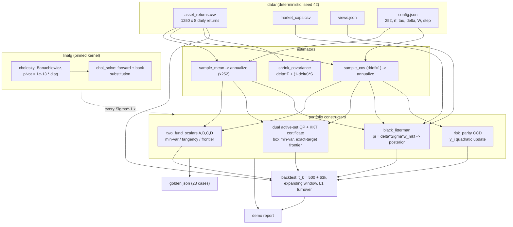
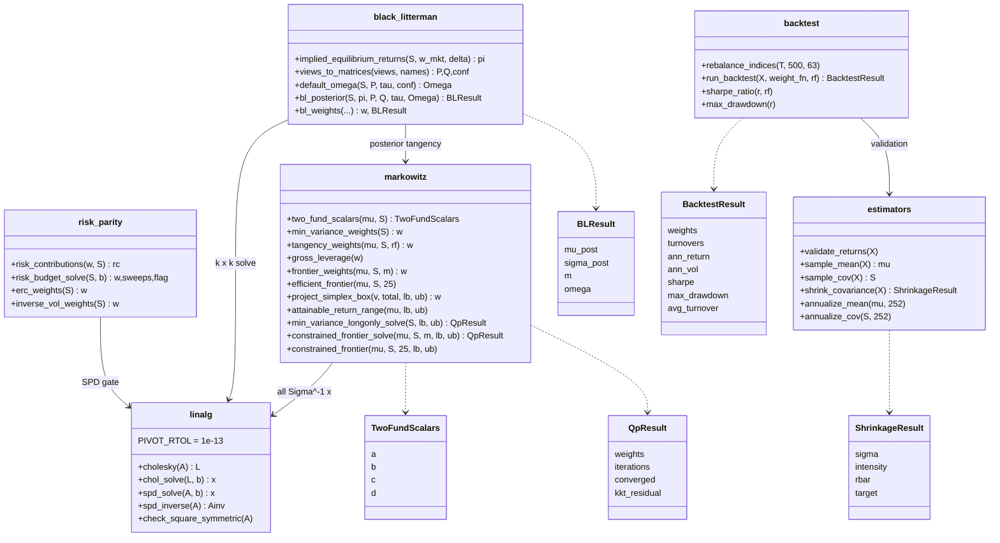
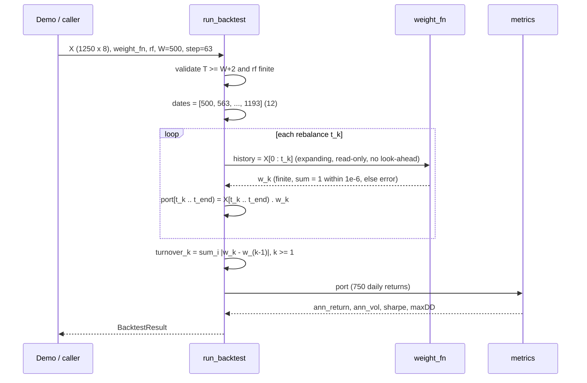

# ARCHITECTURE — portopt

Design notes for the four parallel implementations (Python reference,
C++ `portopt::`, Rust crate `portopt`, Java `com.quant.portopt`). The
binding contract is [API_SPEC.md](../API_SPEC.md): every algorithm is
pinned to the operation level, so this document explains *why* the
pieces are shaped the way they are, not what each formula is (that is
LEARN.md's job).

## 1. Component responsibilities

| Component (Python module) | Responsibility | Depends on |
|---|---|---|
| `linalg` | Pinned Cholesky-Banachiewicz, SPD solve/inverse, symmetry/finiteness validation, compensated summation (ports) | — |
| `estimators` | Sample mean/cov (ddof=1), Ledoit-Wolf constant-correlation shrinkage (paper-exact intensity), annualization, returns validation | — (pure reductions; no factorization) |
| `markowitz` | Two-fund closed forms, frontier sweeps, exact box-simplex projection, attainable-return range, Goldfarb-Idnani dual active-set QP with KKT certificate | `linalg` |
| `black_litterman` | Reverse optimization, view parsing/validation, default Omega, posterior master formula, posterior tangency | `linalg`, `markowitz` |
| `risk_parity` | Risk contributions, CCD risk budgeting/ERC, inverse-vol | `linalg` |
| `backtest` | Pinned rebalance schedule, portfolio return accounting, metrics, turnover | `estimators` (validation) |
| `demo` | End-to-end report wiring all of the above to the bundled data | all |

The dependency graph is a strict DAG with `linalg` at the root of every
optimizer — the single most important structural decision, because
cross-language agreement of *everything* downstream reduces to
cross-language agreement of one Cholesky factorization and two
triangular substitutions. `estimators` deliberately does not depend on
`linalg`: shrinkage is a set of reductions, and the SPD gate belongs to
the consumer of the covariance (every optimizer calls `cholesky` first).

## 2. Data flow

Key flow invariants:

* Golden values are defined on `asset_returns.csv` **as parsed**, not on
  the generator's in-memory arrays; the CSV is written with `%.17g` so
  doubles round-trip exactly and all four parsers see identical bits.
* Every T-length reduction is correctly rounded in Python (`math.fsum`)
  and Neumaier-compensated in the ports, so no golden value depends on
  the BLAS numpy happens to link against.
* Shrinkage runs on *daily* returns (its T-scaling is meaningful there);
  optimizers run on *annualized* moments; scale-invariant methods (ERC,
  inverse-vol) accept either.
* Black-Litterman lives entirely in excess-return space: `pi` comes out
  of reverse optimization as an excess return, so posterior tangency is
  pinned at `rf = 0`.

## 3. Module structure

The backtest engine is deliberately *generic*: `run_backtest` takes a
`weight_fn(history) -> weights` callback (Python callable, C++
`std::function`, Rust closure, Java functional interface), so the six
comparison methods of API_SPEC 6.3 are thin adapters in the demo, not
baked into the engine. The history handed to the callback is a read-only
view (Python) or a copy (ports), so a mutating strategy cannot corrupt
later rebalances. The rebalance loop is worth seeing as a sequence,
because its indexing is the part ports most often get wrong:

## 4. Numerical design decisions and trade-offs

**One factorization, pinned to the operation.** All linear systems —
two-fund solves, BL's k×k system, SPD inverses, the QP's Gram systems —
go through the same Cholesky-Banachiewicz code with a fixed accumulation
order. Trade-off: we forgo BLAS-blocked speed and pivoted rescue
strategies; we gain bit-level reproducibility across four languages, and
at n ≤ 20 blocked speed is irrelevant. Every "inverse" is realized as
solves against identity columns, never an explicit inverse formula —
better conditioning and one less algorithm to pin.

**Relative Cholesky pivot gate (`s <= 1e-13 * A[i][i]`).** A duplicated
asset makes the pivot a tiny *rounding residual*, not an exact zero, so
an absolute test would be scale-dependent. The relative gate rejects
condition numbers beyond ~1e13 — far outside any valid 8-asset
covariance — and doubles as the project-wide PSD validity check: the QP,
CCD and BL all call it before iterating. It is deliberately permissive:
a desk that needs to refuse κ > 1e8 should shrink first (LEARN 3) or add
its own eigenvalue diagnostic.

**Reductions that do not depend on the BLAS.** The first version of this
project pinned the 10,000th iterate of a projected-gradient loop as a
golden value; that iterate was sensitive to the last bit of the sample
covariance, and matching it forced every port to re-implement OpenBLAS
kernels. The fix was structural, not cosmetic: every golden quantity is
now a closed form or the exact solution of a finite algorithm, and every
T-length sum is correctly rounded (`math.fsum`) in the reference and
compensated (Neumaier) in the ports. The suites verify that scaling the
input returns by `1 + 2^-52` moves the QP goldens by < 1e-13.

**Exact projection instead of iterative projection.** The box-simplex
projection exploits piecewise linearity of `g(t)`: one sort of ≤ 2n
breakpoints plus one interpolation gives the *exact* KKT shift. It is
kept as a public utility (repairing rounded weights) and as the
feasibility gate for bound vectors.

**Dual active-set QP instead of first-order methods.** Constrained
min-variance and the constrained frontier are strictly convex QPs with
n ≤ 20 variables. The Goldfarb-Idnani dual method (i) needs no feasible
starting point, (ii) treats the target-return equality exactly, so the
frontier no longer carries a penalty bias, (iii) is finite — each step
strictly increases the dual objective — so "converged" is a certificate
(primal feasibility + stationarity `Sigma w = N u` with `u >= 0`) rather
than a step-size heuristic, and (iv) finishes with a closed-form solve on
the final active set, which makes the answer a function of the active
set and lets four languages agree to 1e-13. Two degenerate cases are
handled explicitly: a fixed coordinate (`lb = ub`) enters as an equality
rather than a pair of dependent bounds, and the maximum-return endpoint
of the frontier — where more constraints are active than there are
coordinates — is reduced analytically to a sum-only QP over the assets
tied at the greedy cut level. A rounding-level violation of a constraint
that is dependent on the active set is accepted (bounded by 1e-9 and
reported in `kkt_residual`) instead of being declared inconsistent.
Trade-off: ~200 lines per language instead of ~40, in exchange for
exactness, an honest flag, and a 25-point sweep in milliseconds instead
of tens of seconds.

**Deterministic CCD for risk parity.** CCD (ascending sweep order,
incremental `Sigma y` cache, `1e-10` sweep tolerance) is a contraction on
the positive orthant for a strictly convex log-barrier objective, so its
fixed point is unique and the iterate is within ~1e-10 of it when the
sweep test fires — comfortably inside the 1e-8 golden tolerance. The
sweep cap is reported via a flag, not raised: near the cap the iterate is
feasible and a batch backtest should not die at rebalance 11 of 12.

**BL master formula in solve form.** The textbook posterior
`[(tauS)^-1 + P'O^-1 P]^-1 [...]` inverts an n×n matrix and requires
invertible Omega; the pinned form factors only the k×k
`A_k = P tauSigma P' + Omega` (k = #views, typically ≪ n) once and
reuses it for both the mean update (one solve) and the posterior
covariance `M = tauS - B' A_k^-1 B` (n solves, one per column of B). It
also stays finite for conflicting extreme views since `A_k` remains SPD.

**Tangency conditioning guard.** `A - rf C` is a difference of two O(A)
numbers; when rf sits within one part per million of the GMV return the
weights scale like `1/(A - rf C)` and reach gross leverage of 1e6+ while
still summing to 1 to 1e-5. The guard rejects that region with a
dedicated exception type so that the demo's fallback policy can match
exactly "tangency undefined or ill-conditioned" and let every other
error (a singular covariance, say) propagate.

**Caps reported, not raised — except where the answer would be wrong.**
CCD hitting its sweep cap returns a flag. The QP returns a certificate
from its `*_solve` variants, but the weights-only wrappers and the sweep
*raise* on a failed certificate: returning an uncertified point as if it
were the minimizer was the failure mode this design replaces. Input
errors always throw — the boundary is "bad data fails fast; slow
convergence degrades gracefully; a wrong answer never leaves silently".

**Turnover on target weights.** Turnover compares consecutive *target*
vectors (L1), not drifted end-of-block holdings — pinned because the
within-block convention is daily rebalancing to target (portfolio
return = `w·r_t` exactly), making the accounting identity testable.

## 5. Error-handling strategy per language

Identical conditions, identical messages in spirit, idiomatic mechanics
(API_SPEC section 7 has the full condition table):

| Language | Invalid input | Tangency undefined / ill-conditioned | Iteration cap |
|---|---|---|---|
| Python | `raise ValueError("...")` | `TangencyUndefinedError(ValueError)` | CCD: `converged=False` in the tuple; QP: `QpResult.converged` (wrappers raise) |
| C++ | `throw std::invalid_argument` (shape/NaN/asymmetry) or `std::domain_error` (not-PD, degenerate) | `TangencyUndefinedError : std::domain_error` | flag field in `RiskBudgetResult` / `QpResult` (wrappers throw `std::domain_error`) |
| Rust | `Err(PortOptError::InvalidInput / NotPositiveDefinite / Undefined / Infeasible)` — no panics on data | `Err(PortOptError::TangencyUndefined)` | flag field in `CcdResult` / `QpResult` (wrappers return `Err(Undefined)`) |
| Java | `throw IllegalArgumentException` | `Markowitz.TangencyUndefinedException extends IllegalArgumentException` | flag field in `Solution` / `QpResult` (wrappers throw) |

Validation is layered: shape/finiteness/symmetry checks run before any
arithmetic (`check_square_symmetric`, `validate_returns` incl. the
`r > -1` rule, view/budget/bound validators, finite `rf` and positive
`periods`), and the Cholesky pivot supplies the semantic PSD check.
Error messages carry the offending numbers (pivot value, row index,
bound sums, attainable return range) because "not positive definite"
without context is undebuggable in a 12-rebalance loop.

## 6. Testing strategy

Four layers, mirrored in every language (Python 114, C++ 90, Rust 58,
Java 108 tests):

1. **Golden values** (`data/golden/golden.json`, exactly 23 cases —
   every suite asserts the count): flat name/inputs/expect/tol schema
   parsed by numpy-free readers in each port. Closed forms and QP results
   at 1e-10..1e-12; CCD and backtest metrics at 1e-8/1e-9. The generator
   refuses to write golden values unless the closed forms match
   `numpy.linalg.lstsq`, the Ledoit-Wolf intensity matches a
   transcription of `covCor.m`, the QP cases match scipy SLSQP with a KKT
   residual < 1e-12, ERC satisfies the equal-contribution identity, and
   both BL limits hold.
2. **Property/identity checks** (grid-style loops): frontier variance
   convex in the target and matching `(Cm^2 - 2Am + B)/D`; tangency has
   max Sharpe on a frontier grid; risk contributions sum to 1 at 1e-12;
   ERC permutation-equivariant and scale-invariant; the QP equals the
   closed form to 1e-14 when constraints are inactive, satisfies the
   long-only KKT conditions to 1e-13, beats projected random feasible
   points, matches SLSQP (Python), and certifies degenerate inputs (fixed
   assets, tied returns, the max-return endpoint); shrinkage matches the
   paper on hand panels and repairs a singular T ≤ N sample; projection
   Euclidean optimality; backtest accounting identity.
3. **Limit and stability tests**: BL with huge Omega → prior; fixed
   Omega, tau → 0 → prior; zero-confidence ≈ ignored view; ERC with an
   almost-zero-vol asset still converges; scaling the returns by one ulp
   moves the QP goldens by < 1e-13.
4. **Error-path tests**: every row of the API_SPEC section 7 table has a
   test asserting the right exception/variant in every language — tangency
   near the GMV return, empty frontier grid, unattainable targets, same-leg
   views, unknown names, missing keys, NaN q, Omega + confidences, returns
   ≤ −1, NaN rf, non-positive periods, T = window + 1, huge rebalance
   steps — plus determinism (two runs, bit-identical results).

The COOKBOOK snippets are additionally extracted and compiled/run
against the shipped libraries as part of the release check.

## 7. Performance notes

* n = 8 assets: a Cholesky is ~120 flops; the entire 25-point
  unconstrained frontier reuses one factorization (`g`, `h` computed
  once). Nothing here is performance-critical in the usual sense.
* The dual active-set QP takes ≤ ~2n iterations (4 for the bundled
  long-only min-variance, 9 for the frontier point at 8%), each costing
  a handful of n-vector Cholesky solves plus a q×q Gram factorization
  (q = active constraints ≤ n). The 25-point constrained sweep runs in
  ~30 ms in Python and well under a millisecond in the native ports.
* The Python demo runs in ~0.3 s end to end (six backtests × 12
  rebalances included); the native demos are faster still. The whole
  Python test suite (including scipy cross-checks) runs in ~1 s.
* `shrink_covariance` is O(T·n²) with T = 1250 — the largest single
  computation; the column-pair loop keeps memory at O(T) per pair
  instead of materializing the T×n×n cross-product tensor.
* CCD converges in ~14 sweeps on the bundled data (tolerance 1e-10);
  the incremental `Sigma y` cache makes a sweep O(n²) instead of O(n³).
* Build budget: the 2-CPU build uses `-j2`; a full C++ configure+build
  from scratch is ~1 minute, the Rust release build ~20 s.

## 8. Diagram sources

The raw Mermaid sources for the three diagrams above live in
[`diagrams/`](diagrams/): `dataflow.mmd`, `modules.mmd`,
`backtest_sequence.mmd`; they are validated with `mmdc` as part of the
docs check.
