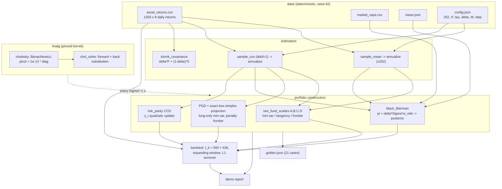
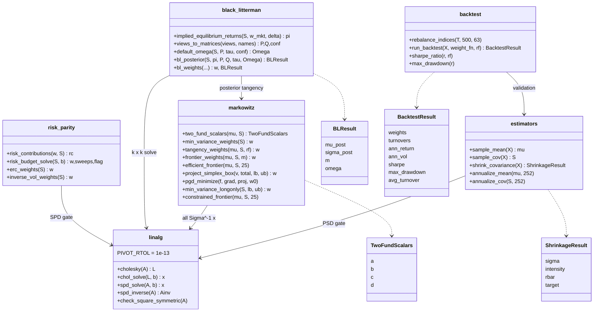
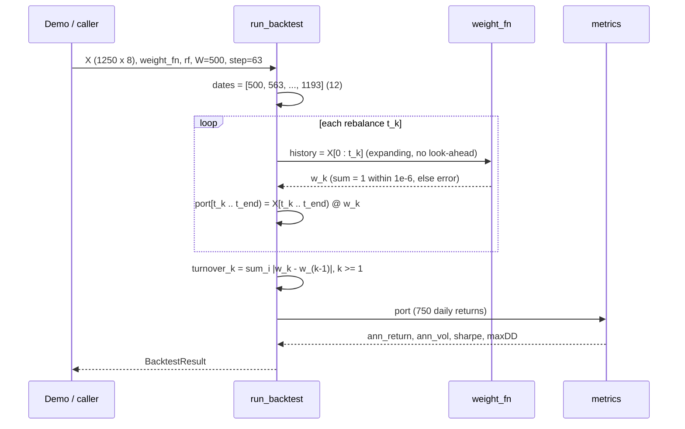

# ARCHITECTURE — portopt

Design notes for the four parallel implementations (Python reference,
C++ `portopt::`, Rust crate `portopt`, Java `com.quant.portopt`). The
binding contract is [API_SPEC.md](../API_SPEC.md): every algorithm is
pinned to the operation level, so this document explains *why* the
pieces are shaped the way they are, not what each formula is (that is
LEARN.md's job).

## 1. Component responsibilities

| Component (Python module) | Responsibility | Depends on |
|---|---|---|
| `linalg` | Pinned Cholesky-Banachiewicz, SPD solve/inverse, symmetry/finiteness validation | — |
| `estimators` | Sample mean/cov (ddof=1), Ledoit-Wolf constant-correlation shrinkage, annualization | `linalg` (PSD gate) |
| `markowitz` | Two-fund closed forms, frontier sweeps, exact box-simplex projection, deterministic PGD | `linalg` |
| `black_litterman` | Reverse optimization, view parsing, default Omega, posterior master formula, posterior tangency | `linalg`, `markowitz` |
| `risk_parity` | Risk contributions, CCD risk budgeting/ERC, inverse-vol | `linalg` |
| `backtest` | Pinned rebalance schedule, portfolio return accounting, metrics, turnover | `estimators` (validation) |
| `demo` | End-to-end report wiring all of the above to the bundled data | all |

The dependency graph is a strict DAG with `linalg` at the root — the
single most important structural decision, because cross-language
agreement of *everything* downstream reduces to cross-language agreement
of one Cholesky factorization and two triangular substitutions.

## 2. Data flow

Key flow invariants:

* Golden values are defined on `asset_returns.csv` **as parsed**, not on
  the generator's in-memory arrays; the CSV is written with `%.17g` so
  doubles round-trip exactly and all four parsers see identical bits.
* Shrinkage runs on *daily* returns (its T-scaling is meaningful there);
  optimizers run on *annualized* moments; scale-invariant methods (ERC,
  inverse-vol) accept either.
* Black-Litterman lives entirely in excess-return space: `pi` comes out
  of reverse optimization as an excess return, so posterior tangency is
  pinned at `rf = 0`.

## 3. Module structure

The backtest engine is deliberately *generic*: `run_backtest` takes a
`weight_fn(history) -> weights` callback (Python callable, C++
`std::function`/template, Rust closure, Java functional interface), so
the six comparison methods of API_SPEC 6.3 are thin adapters in the
demo, not baked into the engine. The rebalance loop is worth seeing as a
sequence, because its indexing is the part ports most often get wrong:

## 4. Numerical design decisions and trade-offs

**One factorization, pinned to the operation.** All linear systems —
two-fund solves, BL's k×k system, SPD inverses — go through the same
Cholesky-Banachiewicz code with a fixed accumulation order. Trade-off:
we forgo BLAS-blocked speed and pivoted rescue strategies; we gain
bit-level reproducibility across four languages, and at n ≤ 20 blocked
speed is irrelevant. Every "inverse" is realized as solves against
identity columns, never an explicit inverse formula — better
conditioning and one less algorithm to pin.

**Relative Cholesky pivot gate (`s <= 1e-13 * A[i][i]`).** A duplicated
asset makes the pivot a tiny *rounding residual*, not an exact zero, so
an absolute test would be scale-dependent. The relative gate rejects
condition numbers beyond ~1e13 — far outside any valid 8-asset
covariance — and doubles as the project-wide PSD validity check
(estimators, PGD, CCD, BL all call it before iterating).

**Exact projection instead of iterative projection.** The box-simplex
projection exploits piecewise linearity of `g(t)`: one sort of ≤ 2n
breakpoints plus one interpolation gives the *exact* KKT shift. This
removes an entire tolerance from the PGD stack — the only approximate
part of constrained optimization is the outer gradient loop, which is
why constrained golden cases can hold 1e-8 across languages.

**Penalty formulation for the constrained frontier.** An equality
constraint `mu'w = m` intersected with the box-simplex has no cheap
exact projection. The pinned choice is a quadratic penalty
(`penalty = 1e4`) *declared to be the contract*: golden values are the
minimizer of the penalized objective, and the O(1/penalty) target miss
is documented rather than hidden. Trade-off: a small, controlled bias in
exchange for reusing the exact projection and keeping PGD's convergence
theory intact.

**Deterministic first-order methods over QP libraries.** PGD (doubling +
halving backtracking, sufficient-decrease test, `max|dw| < 1e-12`) and
CCD (ascending sweep order, incremental `Sigma y` cache, `1e-10` sweep
tolerance) are simple enough to re-implement identically in any
language. A production system would use an interior-point QP; here the
selection criterion is reproducibility, and convexity guarantees the
iterates of all ports converge to the same unique minimizer.

**BL master formula in solve form.** The textbook posterior
`[(tauS)^-1 + P'O^-1 P]^-1 [...]` inverts an n×n matrix and requires
invertible Omega; the pinned form factors only the k×k
`A_k = P tauSigma P' + Omega` (k = #views, typically ≪ n) once and
reuses it for both the mean update and the posterior covariance
`M = tauS - B' A_k^-1 B`. It also stays finite for conflicting extreme
views since `A_k` remains SPD.

**Caps reported, not raised.** PGD and CCD hitting their iteration caps
return a `converged` flag instead of throwing: near the cap the iterate
is still feasible and usually accurate, and a batch backtest should not
die at rebalance 11 of 12. Input errors, by contrast, always throw —
the boundary is "bad data fails fast; slow convergence degrades
gracefully".

**Turnover on target weights.** Turnover compares consecutive *target*
vectors (L1), not drifted end-of-block holdings — pinned because the
within-block convention is daily rebalancing to target (portfolio
return = `w·r_t` exactly), making the accounting identity testable.

## 5. Error-handling strategy per language

Identical conditions, identical messages in spirit, idiomatic mechanics
(API_SPEC section 7 has the full condition table):

| Language | Invalid input | Iteration cap |
|---|---|---|
| Python | `raise ValueError("...")` | `converged=False` in result tuple/dataclass |
| C++ | `throw std::invalid_argument` (shape/NaN/asymmetry) or `std::domain_error` (tangency undefined, not-PD) | flag field in result struct |
| Rust | `Err(PortOptError::...)` — manual thiserror-style enum, no panics on bad input | flag field in result struct |
| Java | `throw IllegalArgumentException` | flag field in result object |

Validation is layered: shape/finiteness/symmetry checks run before any
arithmetic (`check_square_symmetric`, `validate_returns`, view/budget
validators), and the Cholesky pivot supplies the semantic PSD check.
Error messages carry the offending numbers (pivot value, row index,
bound sums) because "not positive definite" without context is
undebuggable in a 12-rebalance loop.

## 6. Testing strategy

Four layers, mirrored in every language (Python: 85 tests):

1. **Golden values** (`data/golden/golden.json`, 21 cases): flat
   name/inputs/expect/tol schema parsed by numpy-free readers in each
   port. Closed forms at 1e-10..1e-12; iterative solvers at 1e-8;
   backtest metrics at 1e-8. The generator refuses to write golden
   values unless the closed forms match `numpy.linalg.lstsq`, ERC
   satisfies the equal-contribution identity, and both BL limits hold.
2. **Property/identity checks** (grid-style loops): frontier variance
   convex in the target and matching `(Cm^2 - 2Am + B)/D`; tangency has
   max Sharpe on a frontier grid; risk contributions sum to 1 at 1e-12;
   PGD equals the closed form when constraints are inactive (1e-6);
   shrinkage intensity in [0,1] and shrunk matrix passes Cholesky;
   projection idempotence and hand cases; backtest accounting identity.
3. **Limit tests**: BL with huge Omega → prior; fixed Omega, tau → 0 →
   prior; zero-confidence ≈ ignored view; ERC with an almost-zero-vol
   asset still converges (weight → 1).
4. **Error-path tests**: every row of the API_SPEC section 7 table has
   a test asserting the right exception/variant, plus determinism
   (two runs, bit-identical results).

## 7. Performance notes

* n = 8 assets: a Cholesky is ~120 flops; the entire 25-point
  unconstrained frontier reuses one factorization. Nothing here is
  performance-critical in the usual sense.
* The hot paths are the iterative solvers inside the backtest:
  6 methods × 12 rebalances, each PGD iteration costing one `Sigma w`
  (O(n²)) plus a projection (O(n log n)). Total demo runtime is well
  under a second in the native ports and a few seconds in Python
  (explicit loops in `linalg`/`shrink_covariance` are pinned-order by
  design — numpy is used as a container, not a kernel).
* `shrink_covariance` is O(T·n²) with T = 1250 — the largest single
  computation; the column-pair loop keeps memory at O(T) per pair
  instead of materializing the T×n×n cross-product tensor.
* CCD converges in ~14 sweeps on the bundled data (tolerance 1e-10);
  the incremental `Sigma y` cache makes a sweep O(n²) instead of O(n³).
* Test-suite budget: < 60 s per language (CONVENTIONS), dominated by
  the constrained-frontier PGD sweeps; the 2-CPU build uses `-j2`.

## 8. Diagram sources

The raw Mermaid sources for the three diagrams above live in
[`diagrams/`](diagrams/): `dataflow.mmd`, `modules.mmd`,
`backtest_sequence.mmd`.
