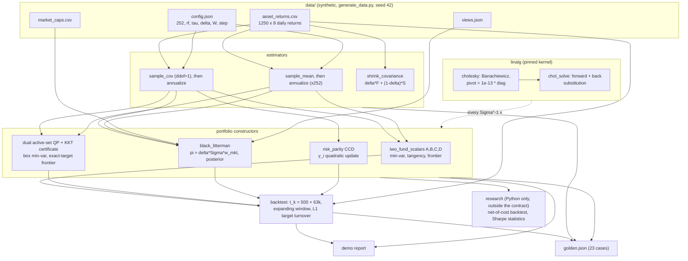
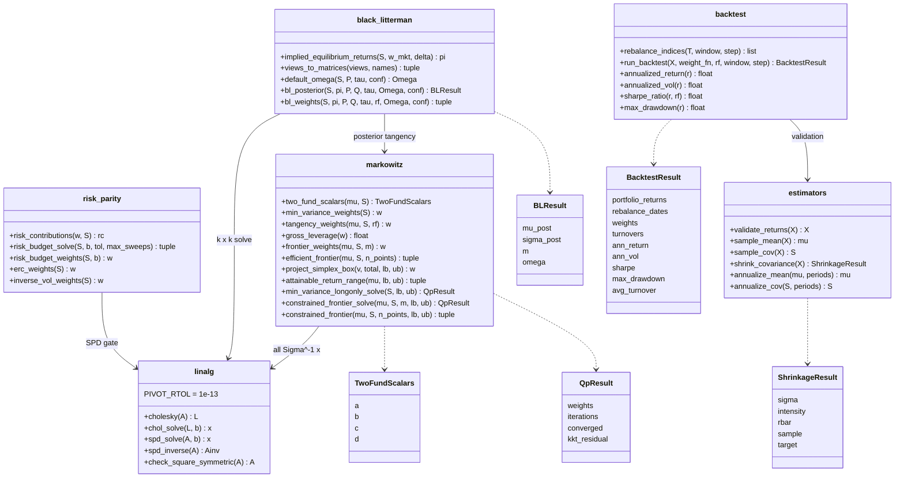
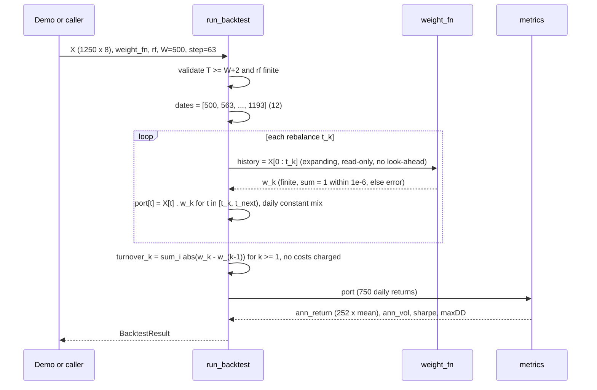
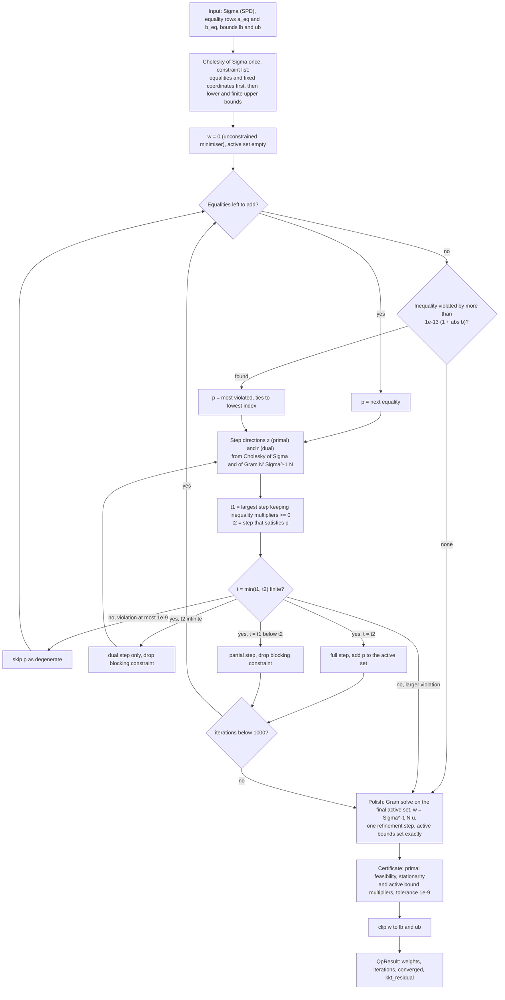
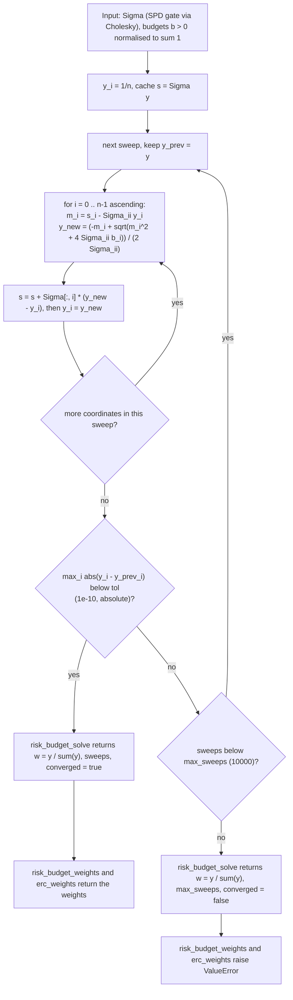
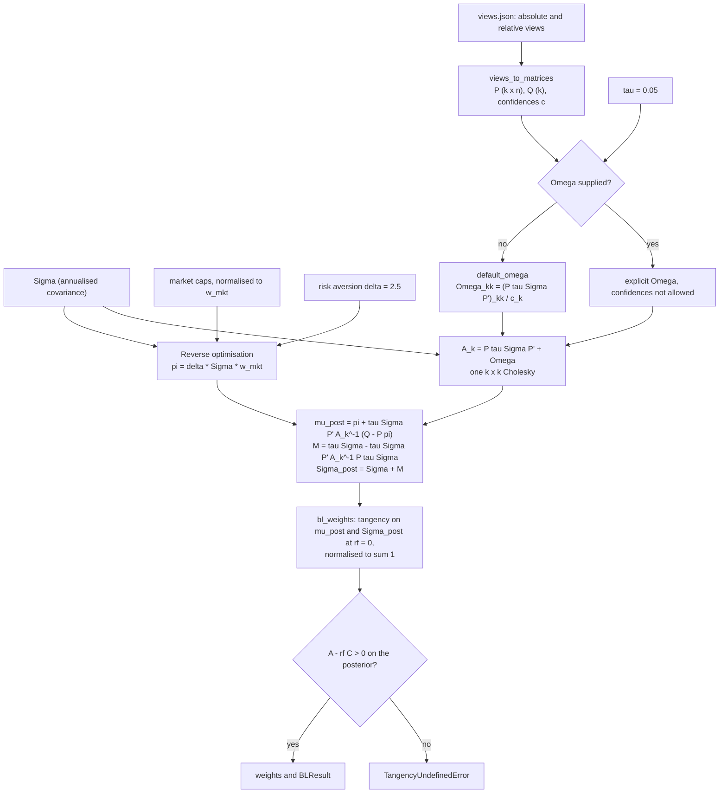
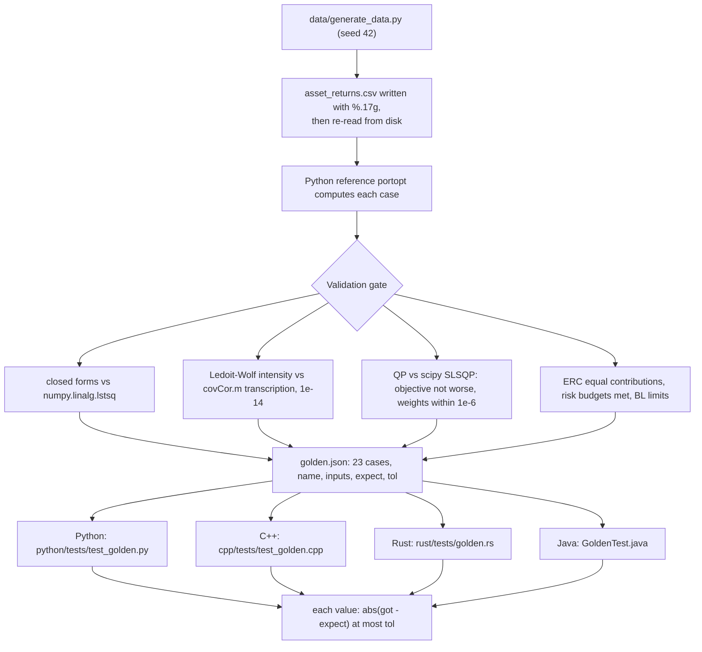
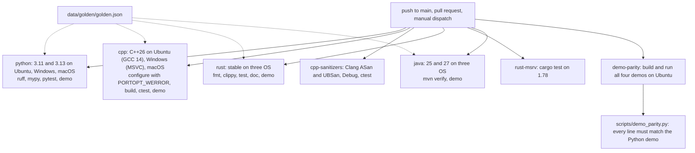

# ARCHITECTURE: portopt 1.2.0

Design notes for the four parallel implementations: the Python
reference (`python/src/portopt`), the C++26 library (`portopt::`, in
`cpp/`), the Rust crate `portopt` (`rust/`) and the Java 25 package
`com.quant.portopt` (`java/`). The binding contract is
[API_SPEC.md](../API_SPEC.md): every algorithm is pinned to the operation
level. This document explains why the pieces are shaped the way they are;
[LEARN.md](../LEARN.md) explains the mathematics.

All four implementations are at version 1.2.0 (`python/pyproject.toml`,
`cpp/CMakeLists.txt`, `rust/Cargo.toml`, `java/pom.xml`). The bundled
data is synthetic (`data/generate_data.py`, seed 42); performance and
accuracy figures below describe the code on that data.

## 1. Component responsibilities

| Component (Python module) | Responsibility | Depends on |
|---|---|---|
| `linalg` | Pinned Cholesky-Banachiewicz, SPD solve and inverse, symmetry and finiteness validation; compensated summation in the ports | nothing |
| `estimators` | Sample mean and covariance (ddof=1), Ledoit-Wolf constant-correlation shrinkage (paper-exact intensity), annualisation, returns validation | nothing (pure reductions, no factorisation) |
| `markowitz` | Two-fund closed forms, frontier sweeps, exact box-simplex projection, attainable-return range, Goldfarb-Idnani dual active-set QP with KKT certificate | `linalg` |
| `black_litterman` | Reverse optimisation, view parsing and validation, default Omega, posterior master formula, posterior tangency | `linalg`, `markowitz` |
| `risk_parity` | Risk contributions, CCD risk budgeting and ERC, inverse volatility | `linalg` |
| `backtest` | Pinned rebalance schedule, portfolio return accounting, metrics, target turnover | `estimators` (validation) |
| `research` (Python only) | Net-of-cost backtest on drifted weights, no-trade band, partial rebalance, volatility targeting; Sharpe standard error, probabilistic and deflated Sharpe, block bootstrap | the modules above |
| `demo` | End-to-end report on the bundled data | all pinned modules |

The pinned modules form a strict DAG with `linalg` at the root of every
optimiser. Cross-language agreement of everything downstream therefore
reduces to agreement of one Cholesky factorisation and two triangular
substitutions. `estimators` does not depend on `linalg`: shrinkage is a
set of reductions, and the SPD gate belongs to the consumer of the
covariance (every optimiser calls `cholesky` first).

**The research layer.** `python/src/portopt/research/` is a Python-only
layer for studies that the pinned contract does not cover: a backtest
that charges costs on drifted holdings, rebalancing rules (no-trade band,
partial rebalance, volatility targeting), and the statistics needed to
read a backtest (Lo 2002 Sharpe standard error, probabilistic and
deflated Sharpe ratios, block bootstrap). It is outside API_SPEC and
`golden.json`, has no C++, Rust or Java counterpart, and may change
between minor versions. Its study results are written up in
[`docs/results/cost_aware_allocation.md`](results/cost_aware_allocation.md).

## 2. Data flow

Flow invariants:

* Golden values are defined on `asset_returns.csv` as parsed, not on the
  generator's in-memory arrays. The CSV is written with `%.17g`, so
  doubles round-trip exactly and all four parsers see identical bits.
* Every T-length reduction is correctly rounded in Python (`math.fsum`)
  and Neumaier-compensated in the ports, so no golden value depends on the
  BLAS numpy links against.
* Shrinkage runs on daily returns (its T-scaling is meaningful there);
  optimisers run on annualised moments; scale-invariant methods (ERC,
  inverse volatility) accept either.
* Black-Litterman lives in excess-return space: `pi` comes out of reverse
  optimisation as an excess return, so posterior tangency is pinned at
  `rf = 0`.

## 3. Module structure

The backtest engine is generic: `run_backtest` takes a
`weight_fn(history) -> weights` callback (Python callable, C++
`std::function`, Rust closure, Java functional interface), so the six
comparison methods of API_SPEC 6.3 are thin adapters in the demo. The
history handed to the callback is a read-only view (Python) or a copy
(ports), so a mutating strategy cannot corrupt later rebalances. Within
each 63-day block the daily portfolio return is `w_k' r_t`, a
daily-rebalanced constant mix; turnover is measured between consecutive
target vectors and no costs are charged. The rebalance loop is shown as
a sequence because its indexing is the part ports most often get wrong:

## 4. Numerical design decisions and trade-offs

**One factorisation, pinned to the operation.** All linear systems (the
two-fund solves, the Black-Litterman k x k system, SPD inverses, the QP's
Gram systems) go through the same Cholesky-Banachiewicz code with a fixed
accumulation order. We give up BLAS-blocked speed and pivoted rescue
strategies and gain bit-level reproducibility across four languages.
Every inverse is realised as solves against identity columns.

**Relative Cholesky pivot gate (`s <= 1e-13 * A[i][i]`).** A duplicated
asset makes the pivot a tiny rounding residual rather than an exact zero,
so an absolute test would depend on scale. The relative gate rejects
condition numbers beyond about 1e13 and doubles as the project-wide
positive-definiteness check: the QP, CCD and Black-Litterman all call it
before iterating. It is permissive by design; a desk that needs to refuse
condition numbers above 1e8 should shrink first (LEARN 3) or add its own
eigenvalue diagnostic.

**Reductions that do not depend on the BLAS.** The first version of this
project pinned the 10,000th iterate of a projected-gradient loop as a
golden value, and that iterate was sensitive to the last bit of the
sample covariance. Every golden quantity is now a closed form or the
exact solution of a finite algorithm, and every T-length sum is correctly
rounded in the reference and compensated in the ports. The suites check
that scaling the input returns by `1 + 2^-52` moves the QP goldens by
less than 1e-13 (`python/tests/test_golden.py`).

**Exact projection.** The box-simplex projection exploits the piecewise
linearity of `g(t) = sum_i clip(v_i - t, lb_i, ub_i)`: one sort of at
most 2n breakpoints plus one interpolation gives the exact shift. It is a
public utility for repairing rounded weights and the feasibility gate for
bound vectors.

**Dual active-set QP.** Constrained min-variance and the constrained
frontier are strictly convex QPs. The Goldfarb-Idnani dual method needs
no feasible starting point, treats the target-return equality exactly
(no penalty bias), is finite, and ends with a closed-form solve on the
final active set, which makes the answer a function of the active set.
Two degenerate cases are handled explicitly: a fixed coordinate
(`lb = ub`) enters as an equality, and the maximum-return endpoint of the
frontier is reduced to a sum-only QP over the assets tied at the greedy
cut level. A rounding-level violation of a constraint that is dependent
on the active set is accepted when below 1e-9 and reported in
`kkt_residual`. The loop and its exits:

**Deterministic CCD for risk parity.** CCD with ascending sweep order, an
incremental `Sigma y` cache and a `1e-10` sweep tolerance converges to the
unique minimiser of a strictly convex log-barrier objective. Its fixed
point is unique, so the ports agree well inside the 1e-8 golden
tolerance. The stopping rule is absolute in the unnormalised iterate, so
the achieved accuracy depends on the scale of `Sigma` (LEARN 6.3):

**Black-Litterman master formula in solve form.** The textbook posterior
`[(tau S)^-1 + P' O^-1 P]^-1 [...]` inverts an n x n matrix and needs an
invertible Omega. The pinned form factors only the k x k matrix
`A_k = P tau Sigma P' + Omega` (k views, usually far fewer than n) once
and reuses it for the mean update (one solve) and the posterior
covariance (n solves, one per column of `P tau Sigma`). It stays finite
for conflicting extreme views because `A_k` remains SPD:

**Tangency conditioning guard.** `A - rf C` is a difference of two
numbers of order A. When rf is within one part per million of the GMV
return the weights scale like `1/(A - rf C)` and reach gross leverage of
1e6 or more while still summing to 1. The guard rejects that region with
a dedicated exception type, so the demo's fallback can match exactly
"tangency undefined or ill-conditioned" and let every other error
propagate. Outside the guard leverage can still be large: the demo
backtest reaches gross leverage 93.6 at `t = 1004` (LEARN 7.3).

**Turnover on target weights.** Turnover compares consecutive target
vectors, not drifted end-of-block holdings, because the within-block
convention is daily rebalancing to target, which makes the accounting
identity `port_t = w_k' r_t` testable. The cost of that convention is
that the daily constant-mix trades are invisible (LEARN 7.3 measures
them; the research layer charges them).

## 5. Error handling and convergence reporting

### 5.1 Policy

Three rules apply in every language:

1. **Bad input fails fast.** Shape, finiteness and symmetry checks run
   before any arithmetic (`check_square_symmetric`, `validate_returns`
   including the `r > -1` rule, the view, budget and bound validators,
   finite `rf`, positive `periods`), and the Cholesky pivot supplies the
   positive-definiteness check. Error messages carry the offending
   numbers (pivot value, row index, bound sums, attainable return range).
2. **Diagnostics variants report, wrappers raise.** Each iterative
   solver has a `*_solve` variant that returns its convergence evidence
   and a weights-only wrapper that raises when that evidence fails:

   | Solver | Diagnostics variant returns | Weights-only wrapper |
   |---|---|---|
   | Dual active-set QP | `QpResult(weights, iterations, converged, kkt_residual)` from `min_variance_longonly_solve`, `constrained_frontier_solve` | `min_variance_longonly`, `constrained_frontier_weights`, `constrained_frontier` raise `ValueError` when `converged` is false |
   | CCD risk budgeting | `(weights, sweeps, converged)` from `risk_budget_solve` | `risk_budget_weights`, `erc_weights` raise `ValueError` when `converged` is false (1.2.0) |

3. **No wrong answer leaves silently.** An uncertified QP point or an
   unconverged CCD iterate is available only through the diagnostics
   variant, where the flag travels with it.

### 5.2 What the convergence flags mean

* **QP.** `converged` is a KKT certificate evaluated on the polished
  point, independent of how the loop ended: primal feasibility (every
  equality residual and bound violation at most `1e-9 * (1 + max|b|)`),
  stationarity (`|Sigma w - N u|_inf` at most `1e-9 * (1 + scale)`), and,
  since 1.2.0, dual feasibility (every polished multiplier on an active
  inequality at least `-1e-9 * (1 + scale)`, the stationarity scale;
  `_kkt_certificate` in `markowitz.py`). Complementary slackness holds by construction, because only
  active constraints carry multipliers and active bounds are set exactly.
  `kkt_residual` is the largest of these violations. The certificate is
  computed before the final clip of `w` to `[lb, ub]`. LEARN 4.2 gives
  the conditions and a worked check.
* **CCD.** `converged` means `max_i |y_i - y_i_prev| < tol` after a full
  sweep, within `max_sweeps` (default 10000). The tolerance is absolute,
  so it is not a statement about the risk-contribution error; check
  `risk_contributions` when the scale of `Sigma` is unusual.

### 5.3 Mechanics per language

Identical conditions, idiomatic mechanics (API_SPEC section 7 has the
full condition table):

| Language | Invalid input | Tangency undefined or ill-conditioned | Non-convergence |
|---|---|---|---|
| Python | `ValueError` | `TangencyUndefinedError(ValueError)` | flag in the `*_solve` result; wrappers raise `ValueError` |
| C++ | `std::invalid_argument` (shape, NaN, asymmetry) or `std::domain_error` (not positive definite, degenerate) | `TangencyUndefinedError : std::domain_error` | flag in `QpResult` / `RiskBudgetResult`; wrappers throw `std::domain_error` |
| Rust | `Err(PortOptError::InvalidInput / NotPositiveDefinite / Undefined / Infeasible)`, no panics on data | `Err(PortOptError::TangencyUndefined)` | flag in `QpResult` / `CcdResult`; wrappers return `Err(Undefined)` |
| Java | `IllegalArgumentException` | `Markowitz.TangencyUndefinedException extends IllegalArgumentException` | flag in `QpResult` / `Solution`; wrappers throw |

## 6. Testing strategy

### 6.1 Golden cases and their tolerances

`data/golden/golden.json` holds 23 cases in a flat
name / inputs / expect / tol schema, read by numpy-free parsers in each
port; every suite asserts the case count. Each value is checked with an
absolute tolerance, `abs(got - expect) <= tol`
(`python/tests/test_golden.py::check`). Tolerances per case family, read
from the file:

| Family | Cases | tol |
|---|---|---|
| Sample moments | `sample_moments_daily` | 1e-12 |
| Ledoit-Wolf shrinkage | `shrinkage_const_corr_daily` | 1e-10 |
| Closed forms | `two_fund_scalars_annualized`, `minvar_unconstrained`, `tangency_unconstrained`, `frontier_point_t080` | 1e-10 |
| Dual active-set QP | `minvar_longonly_qp`, `minvar_box_qp`, `frontier_constrained_t080`, `frontier_constrained_box_t060` | 1e-10 |
| Cholesky | `cholesky_annualized_cov` | 1e-12 |
| Simplex projection | `simplex_projection_hand`, `simplex_projection_box` | 1e-12 |
| Black-Litterman | `implied_pi`, `bl_posterior_returns`, `bl_posterior_weights` | 1e-10 |
| Black-Litterman Omega | `bl_omega_default` | 1e-12 |
| Inverse volatility | `inverse_vol` | 1e-12 |
| CCD risk parity | `erc_weights`, `risk_budget_pinned` | 1e-8 |
| Backtest metrics | `backtest_equal_weight`, `backtest_erc` | 1e-8 |
| Backtest turnover | `turnover_minvar_longonly` | 1e-9 |

### 6.2 What is cross-checked against outside references

`data/generate_data.py` refuses to write golden values unless these
checks pass (read from the script):

* closed-form min-variance and tangency weights against
  `numpy.linalg.lstsq` solutions (`atol=1e-11`), and A, B, C against
  direct sums (1e-10);
* the four QP cases against scipy SLSQP: the active-set objective must
  not exceed SLSQP's by more than 1e-12, weights must agree within 1e-6,
  frontier targets must be met within 1e-12, and the KKT residual must be
  below 1e-12;
* the Ledoit-Wolf intensity against a direct transcription of the
  authors' `covCor.m`, within 1e-14;
* ERC risk contributions equal within 1e-9 and risk budgets met within
  1e-9;
* the Black-Litterman limits: `tau -> 0` with fixed Omega returns pi
  within 1e-8, and `Omega = 1e12 * I` returns pi within 1e-10.

The Python suite also compares ERC and the QP with scipy
(`test_erc_matches_scipy`, the SLSQP comparisons in `test_markowitz.py`).

### 6.3 Other test layers

1. **Identity and property checks** (grid-style loops): frontier
   variance matches `(Cm^2 - 2Am + B)/D`; tangency has the highest Sharpe
   on a frontier grid; risk contributions sum to 1 at 1e-12; ERC is
   permutation-equivariant and scale-invariant; the QP equals the closed
   form when no bound binds, satisfies the long-only KKT conditions, and
   beats projected random feasible points; shrinkage repairs a singular
   T <= N sample; the backtest accounting identity holds.
2. **Limit and stability tests**: Black-Litterman with huge Omega or
   fixed Omega and `tau -> 0` returns the prior; ERC with an almost-zero
   volatility asset converges; the one-ulp perturbation test above.
3. **Error-path tests**: each row of the API_SPEC section 7 table has a
   test asserting the right exception or variant, plus determinism (two
   runs, bit-identical results).

The Python suite has 117 tests (`cd python && python -m pytest -q`,
measured for this revision). COOKBOOK.md's eighteen Python recipes were
extracted and run for this revision; the C++, Rust and Java fragments
were not re-compiled.

### 6.4 Known gaps

From the project review of 2026-10-31 (findings 15 and 16), still open
in this revision (the review's third item, a missing length check in the
Rust `check_vec` helper, is fixed: `rust/tests/golden.rs` now counts the
expected keys):

* Matrices are spot-checked rather than compared in full: 3 of 36
  Cholesky entries, 4 shrinkage entries, the Omega diagonal only.
* All tolerances are absolute; the ERC tolerance of 1e-8 on weights near
  0.1 is loose next to the agreement the ports achieve.
* Tests are example-based. There is no hypothesis (Python), proptest
  (Rust) or jqwik (Java) suite, no randomised QP-versus-SLSQP sweep in
  the suite, no fuzzing of the three hand-written parsers, and no
  independent reference for the backtest metrics.

## 7. Continuous integration

`.github/workflows/ci.yml` runs on every push to `main`, every pull
request and on manual dispatch. Each language job runs its golden suite
against the same `golden.json`; the parity job builds all four demos and
`scripts/demo_parity.py` requires every line of the C++, Rust and Java
output to match the Python demo after normalising line endings, trailing
whitespace and the title's dash. CodeQL scanning runs separately
(`.github/workflows/codeql.yml`).

Build entry points per language: `pip install -e "python[dev]"` (Python
>= 3.11, `python/pyproject.toml`); `cmake -S cpp -B cpp/build` and
`cmake --build cpp/build --config Release` (CMake >= 3.25, C++26 via
`CMAKE_CXX_STANDARD 26`, `/std:c++latest` on MSVC, GoogleTest fetched
with `FetchContent` when not installed); `cd rust && cargo test
--release` (`rust-version = 1.78`); `cd java && mvn -B verify` (Java 25
via `maven.compiler.release`).

## 8. Performance

The implementations are written for reproducibility, not speed, and are
dense throughout.

* **Cholesky** is the textbook O(n^3) dense factorisation (about n^3/3
  flops). Every solve is O(n^2). There is no blocking and no BLAS.
* **The QP** stores each bound constraint as a dense n-vector. In every
  iteration it recomputes `Sigma^{-1} n_c` for every active constraint
  (q solves of O(n^2) each), rebuilds the q x q Gram matrix and
  refactors it from scratch (O(q^3)), and allocates new arrays. With q up
  to about n active constraints that is roughly O(q n^2 + q^3) per
  iteration, and the iteration count grows with n, so the total is about
  O(n^4) [derived: `_dual_active_set_qp`]. On the bundled 8-asset data
  the long-only GMV takes 4 iterations, the box problem 8 and the 8%
  frontier point 9 (COOKBOOK 17).
* **Ledoit-Wolf** is O(T n^2) with explicit Python loops over asset pairs
  and correctly rounded `math.fsum` reductions over T.
* **CCD** costs O(n^2) per sweep thanks to the incremental `Sigma y`
  cache; it takes 14 sweeps on the annualised bundled covariance.

Measured on the Python reference by the 2026-10-31 review (Windows 11,
single run): the QP takes about 0.99 s and Ledoit-Wolf about 1.77 s at
n = 100. That is adequate for a reference at n <= 20 and unsuitable above
roughly 50 assets. The full Python suite of 117 tests ran in about 2.4 s
on the same machine for this revision. No benchmark harness exists yet. The planned work
(incremental QR updates of the active set instead of refactoring the Gram
matrix, bounds stored as indices, preallocated workspaces, vectorised
Ledoit-Wolf sums) is listed in section 5 of the review.

## 9. Thread safety

None of the four implementations holds global mutable state. We checked
by grep for this revision: the Python modules define only constants and
`__all__` at module level; the C++ sources contain no `static` variables
(namespace-scope values are `constexpr`); the Rust crate has no
`static mut`, `lazy_static`, `OnceLock`, `RefCell`, `Mutex` or atomics
and only `const` items; the Java classes have no non-final static
fields. Every function computes from its arguments and returns new
results.

Concurrent calls on different inputs are therefore safe. Two caveats:
the inputs themselves are shared, so a caller must not mutate an array
or matrix while another thread is reading it; and the backtest callback
`weight_fn` is the caller's code, so any state it keeps (the demo's
fallback counter, for example) is the caller's responsibility. No test
exercises concurrent use.

## 10. Diagram sources

The Mermaid sources live in [`diagrams/`](diagrams/): `dataflow.mmd`,
`modules.mmd`, `backtest_sequence.mmd`, `qp_active_set.mmd`,
`risk_parity_ccd.mmd`, `black_litterman_flow.mmd`, `golden_parity.mmd`
and `ci_pipeline.mmd`. The `.mmd` files are the sources; this document
carries inline copies in `mermaid` code blocks, which GitHub renders. No
automated check renders or validates them, so edit the `.mmd` file and
the inline copy together.
